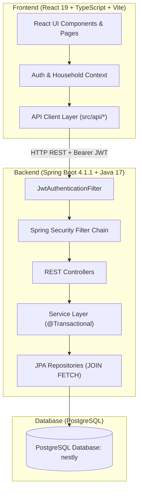

# Nestly — Student Shared Living Platform

> "One place to manage life together."

**YuvaIntern Junior Full Stack Developer Internship — Final Project Submission**  
**Author:** Sakshi Gowda  
**Repository:** [https://github.com/Sakshi-HC-Gowda/nestly-student-shared-living.git](https://github.com/Sakshi-HC-Gowda/nestly-student-shared-living.git)

---

## 1. Project Overview

**Nestly** is a full-stack, mobile-first web application designed to solve the everyday logistical and financial challenges faced by roommates in shared living arrangements — including paying guest (PG) accommodations, student hostels, and rented apartments.

### The Problem
Coordinating life in shared housing is typically disorganized. Roommates rely on fragmented WhatsApp group chats, mental arithmetic, and paper notes to track shared expenses, recurring utility bills, chore rotations, and grocery shopping lists. This lack of structure leads to forgotten dues, disputed splits, neglected chores, and recurring roommate tension.

### The Solution
Nestly provides a single shared source of truth for the entire household:
- **Shared Finances:** Record expenses with custom split models (Equal, Exact, Percentage), calculate net balances, and minimize settlement transactions.
- **Shared Utilities & Bills:** Monitor recurring and one-off bills with automated due date tracking and status indicators.
- **Shared Accountability:** Assign chores with clear deadlines and maintain a collaborative grocery shopping list.
- **Household Scoping:** Isolate data strictly within authorized households using multi-tenant membership checks.

---

## 2. Key Features

### Implemented & Backend-Integrated Features

- **User Authentication & Session Management:**
  - User registration (`POST /api/auth/register`) and login (`POST /api/auth/login`) with BCrypt password hashing.
  - Stateless JSON Web Token (JWT) issuance and client-side storage (`localStorage` key: `nestly.auth.token`).
  - Automatic token attachment via Authorization header on all protected API requests.

- **Household Management & Multi-Tenancy:**
  - Create households (`POST /api/households`) with custom accommodation types (Apartment, House, PG, Hostel).
  - Unique 6-character alphanumeric invite code generation per household.
  - Join existing households by invite code (`POST /api/households/join`) with conflict prevention for duplicate memberships.
  - Household member roster listing (`GET /api/households/{id}/members`) with distinct `OWNER` and `MEMBER` roles.
  - Active household switcher allowing users belonging to multiple households to toggle context instantly.

- **Shared Expenses & Splits:**
  - Add expenses (`POST /api/expenses`) with description, category, amount, payer, and split participants.
  - Validates that the sum of split amounts equals the total expense before persisting.
  - Household expense history (`GET /api/expenses/household/{id}`) with eager-loaded payer details.
  - Detailed split breakdown per expense (`GET /api/expenses/{id}/splits`) with participant IDs and names.

- **Utility Bills Tracking:**
  - Record bills (`POST /api/bills`) with title, amount, category, and due date.
  - Household bills listing (`GET /api/bills/household/{id}`) with automated status calculation (`Upcoming`, `Due`, `Overdue`).

- **Chores Coordination:**
  - Assign household chores (`POST /api/chores`) to specific household members with deadlines and descriptions.
  - Household chores listing (`GET /api/chores/household/{id}`) with assignee and creator names.

- **Grocery Shopping List:**
  - Add grocery items (`POST /api/groceries`) with quantity, estimated price, and status (`PENDING` / `PURCHASED`).
  - Household grocery list (`GET /api/groceries/household/{id}`).

- **Dashboard & Aggregations:**
  - Summary metrics: Monthly spending total, individual pending dues, today's chore count, and upcoming bills.
  - Resilient independent widget fetching so that an error in one module does not break the entire dashboard.

- **Security & Authorization:**
  - Strict household-level authorization: All household endpoints verify that the authenticated user is an active member before returning or mutating data.
  - Returns `403 Forbidden` (`ResponseStatusException`) on unauthorized access attempts.

### Client-Side & Mock Modules (Transparently Documented)

To ensure full transparency for evaluation, the following features operate with client-side logic or mock data:

- **Settlements & Balances:** Net member balances and debt-simplification suggestions (greedy debtor-to-creditor matching algorithm) are computed dynamically on the frontend using actual persisted expense records and household member data. "Mark as Settled" records state in browser session memory (backend settlement endpoint is planned).
- **Analytics:** Category spending breakdown and month-over-month comparisons are dynamically derived on the client from live expense data.
- **Notifications:** Renders simulated notification records (the backend does not yet include a notification entity or controller).
- **Email Delivery:** In-app invitation records are stored in PostgreSQL; automated outbound SMTP email delivery is a planned enhancement.
- **Single-Item Status Updates:** Marking bills as paid, completing chores, or toggling grocery items are updated optimistically in the client UI; dedicated single-item `PUT`/`DELETE` endpoints are not yet implemented in the backend.

---

## 3. Technology Stack

### Frontend
| Technology | Version | Purpose |
|------------|---------|---------|
| **React** | `19.2.8` | Component-based user interface |
| **Vite** | `8.2.0` | Development server and production bundler |
| **TypeScript** | `6.0.2` | Static typing and type safety |
| **Tailwind CSS** | `4.3.3` | Utility-first responsive styling via `@tailwindcss/vite` |
| **React Router** | `7.18.2` | Client-side routing and protected route guards |
| **Lucide React** | `1.33.0` | Accessible, tree-shakeable UI icons |
| **Oxlint** | `1.75.0` | High-performance JavaScript/TypeScript linter |

### Backend
| Technology | Version | Purpose |
|------------|---------|---------|
| **Java** | `17` | Backend programming language (LTS) |
| **Spring Boot** | `4.1.1` | Application framework (WebMVC, Data JPA, Validation) |
| **Spring Security** | `6.x` | Stateless authentication and endpoint authorization |
| **JJWT (Java JWT)** | `0.12.6` | HMAC-SHA256 JWT generation and validation |
| **Hibernate / JPA** | `7.4.5` | Object-relational mapping with PostgreSQL dialect |
| **PostgreSQL Driver** | `42.7.x` | Relational database connectivity |
| **SpringDoc OpenAPI** | `2.8.13` | Interactive Swagger UI and OpenAPI 3.0 documentation |
| **Apache Maven** | `3.9.x` (via `mvnw`) | Dependency management and build lifecycle |
| **JUnit 5 & Mockito** | Latest | Unit testing and service mocking |

---

## 4. Architecture

Nestly follows a decoupled client-server architecture with stateless RESTful communication over HTTP:



### Architecture Highlights
1. **Stateless Authentication:** The client sends an `Authorization: Bearer <token>` header with every API request. The `JwtAuthenticationFilter` validates the signature and extracts the user identity without server-side session state.
2. **Transaction Boundaries & Eager Fetching:** Services are annotated with `@Transactional(readOnly = true)` (with `@Transactional` for write operations). Repositories utilize explicit `JOIN FETCH` queries to initialize lazy associations within the database transaction, preventing `LazyInitializationException` and N+1 query problems.
3. **Multi-Tenancy Guard:** Before executing operations on expenses, bills, chores, or groceries, services verify that the requesting user belongs to the target household via `HouseholdMemberRepository.existsByUserIdAndHouseholdId`.

---

## 5. Project Structure

```
nestly/
├── backend/                                # Spring Boot Application Root
│   ├── src/main/java/com/nestly/nestly_backend/
│   │   ├── config/                        # SecurityConfig, CorsConfigurationSource
│   │   ├── controller/                    # Auth, Household, Expense, Bill, Chore, Grocery
│   │   ├── dto/                           # Request & Response Data Transfer Objects
│   │   ├── entity/                        # JPA Entities (User, Household, Expense, etc.)
│   │   ├── exception/                     # GlobalExceptionHandler, Custom exceptions
│   │   ├── repository/                    # Spring Data JPA Repositories (with JOIN FETCH)
│   │   ├── security/                      # JwtService, JwtAuthenticationFilter
│   │   ├── service/                       # Business logic and transaction management
│   │   └── NestlyBackendApplication.java  # Spring Boot Main Entry Point
│   ├── src/main/resources/
│   │   └── application.properties         # Database, JPA, JWT, and Server configuration
│   ├── src/test/java/                     # Unit and Service regression tests
│   ├── mvnw / mvnw.cmd                    # Maven wrapper scripts
│   └── pom.xml                            # Backend dependencies and plugins
│
├── src/                                    # React Frontend Application Root
│   ├── api/                               # Typed API service modules (client.ts, expenses.ts, etc.)
│   ├── assets/                            # Static images and brand assets
│   ├── components/
│   │   ├── common/                        # Reusable UI primitives (Button, Modal, Input, Badge)
│   │   ├── household/                     # HouseholdSwitcher, InviteCodeCard
│   │   ├── expenses/                      # ExpenseList, AddExpenseModal
│   │   ├── bills/                         # BillList, AddBillModal
│   │   ├── chores/                        # ChoreList, AddChoreModal
│   │   ├── groceries/                     # GroceryList, GroceryItemModal
│   │   ├── layout/                        # AppShell, TopBar, PageHeader
│   │   └── navigation/                    # Sidebar (desktop), BottomNav (mobile)
│   ├── context/                           # AuthContext, HouseholdContext
│   ├── hooks/                             # useAuth, useHousehold custom hooks
│   ├── pages/                             # Route page components (Dashboard, Expenses, Login, etc.)
│   ├── routes/                            # ProtectedRoute, RequireHousehold route guards
│   ├── types/                             # TypeScript interface definitions
│   └── utils/                             # Formatters, validation, and styling helpers
│
├── package.json                            # Frontend dependencies and npm scripts
├── vite.config.ts                         # Vite build configuration
└── README.md                              # Project documentation
```

---

## 6. Prerequisites

Ensure the following tools are installed on your machine before running the application:

- **Java Development Kit (JDK):** Version 17 or higher (`java -version`)
- **Node.js:** Version 18.x or higher (`node -v`) and npm (`npm -v`)
- **PostgreSQL:** Version 14 or higher (`psql -V`), running locally on port `5432`
- **Git:** Version 2.x (`git -v`)

---

## 7. Local Setup and Installation

Follow these tested step-by-step instructions in **Windows PowerShell**:

### Step 1: Clone the Repository
```powershell
git clone https://github.com/Sakshi-HC-Gowda/nestly-student-shared-living.git
cd nestly-student-shared-living
```
*(If working directly in the project folder, open `c:\Users\<YourUser>\Downloads\nestly-fullstack\nestly`)*

### Step 2: Configure the PostgreSQL Database
Open PostgreSQL via `psql` or pgAdmin and create the `nestly` database:
```sql
CREATE DATABASE nestly;
```

### Step 3: Start the Backend (Terminal 1)
Navigate to the `backend` directory, set the local environment variables, and launch the Spring Boot application using the Maven wrapper:

```powershell
cd backend

# Configure environment variables (replace placeholders with your local values)
$env:DB_USERNAME="postgres"
$env:DB_PASSWORD="your_postgres_password"
$env:JWT_SECRET="NestlyJwtSecretKey2026ForLocalDevelopmentOnlyMustBeAtLeast256BitsLong"

# Run Spring Boot
.\mvnw.cmd spring-boot:run
```

The backend starts at `http://localhost:8080`.  
- API Base URL: `http://localhost:8080/api`
- Swagger UI Documentation: `http://localhost:8080/swagger-ui.html`

### Step 4: Start the Frontend (Terminal 2)
Open a new terminal window in the root `nestly` directory, install npm dependencies, and start the Vite development server:

```powershell
# From the nestly root folder
npm install

# Start Vite dev server
npm run dev
```

The frontend will run at `http://localhost:5173`.

### Step 5: Verify the Application
1. Open your browser and navigate to `http://localhost:5173`.
2. Click **Register** to create a new user account.
3. Log in with your new credentials.
4. Create your first household (e.g., "Maple Villa") or join an existing one using an invite code.
5. Add expenses, bills, chores, and groceries, and verify that the dashboard reflects the changes upon browser refresh.

---

## 8. Environment Configuration

### Backend (`application.properties`)
The backend reads configuration from environment variables with safe development defaults:

| Variable | Description | Default Fallback |
|----------|-------------|------------------|
| `DB_USERNAME` | PostgreSQL database user | `postgres` |
| `DB_PASSWORD` | PostgreSQL database password | *(none; must be provided)* |
| `JWT_SECRET` | 256-bit secret key for signing HMAC-SHA256 JWTs | Development fallback key |
| `server.port` | HTTP port for Spring Boot | `8080` |

> [!IMPORTANT]
> Never commit real database passwords or production JWT secrets to source control. Always inject credentials through environment variables or secure vault configuration.

### Frontend
By default, the frontend connects to `http://localhost:8080/api`. If you need to override the backend URL, create a `.env` file in the frontend root:
```env
VITE_API_BASE_URL=http://localhost:8080/api
```

---

## 9. API Documentation

All endpoints are hosted under the `/api` prefix. Interactive API documentation is available via **Swagger UI** at `http://localhost:8080/swagger-ui.html`.

### Authentication (`/api/auth`)
| Method | Path | Auth Required | Description |
|--------|------|:-------------:|-------------|
| `POST` | `/api/auth/register` | No | Register a new user account |
| `POST` | `/api/auth/login` | No | Authenticate user and return JWT |
| `GET` | `/api/auth/test` | No | Public endpoint health check |

### Households (`/api/households`)
| Method | Path | Auth Required | Description |
|--------|------|:-------------:|-------------|
| `POST` | `/api/households` | Yes | Create a household (creator assigned `OWNER` role) |
| `GET` | `/api/households` | Yes | Retrieve all households the authenticated user belongs to |
| `GET` | `/api/households/{id}/members` | Yes (Member) | Get member roster with roles (`OWNER`/`MEMBER`) |
| `GET` | `/api/households/{id}/invite-code` | Yes (Member) | Retrieve or generate the 6-character invite code |
| `POST` | `/api/households/join` | Yes | Join a household using an invite code |

### Invitations (`/api/households`)
| Method | Path | Auth Required | Description |
|--------|------|:-------------:|-------------|
| `POST` | `/api/households/{id}/invitations` | Yes (Member) | Create an invitation record for a user email |
| `PUT` | `/api/households/invitations/{id}/accept` | Yes | Accept an invitation and join the household |

### Expenses (`/api/expenses`)
| Method | Path | Auth Required | Description |
|--------|------|:-------------:|-------------|
| `POST` | `/api/expenses` | Yes (Member) | Create a shared expense and calculate participant splits |
| `GET` | `/api/expenses/household/{id}` | Yes (Member) | List all household expenses with payer details |
| `GET` | `/api/expenses/{id}/splits` | Yes (Member) | List participant split breakdown for an expense |

### Bills (`/api/bills`)
| Method | Path | Auth Required | Description |
|--------|------|:-------------:|-------------|
| `POST` | `/api/bills` | Yes (Member) | Create a utility bill with due date and amount |
| `GET` | `/api/bills/household/{id}` | Yes (Member) | List household bills with creator details |

### Chores (`/api/chores`)
| Method | Path | Auth Required | Description |
|--------|------|:-------------:|-------------|
| `POST` | `/api/chores` | Yes (Member) | Create a chore assigned to a household roommate |
| `GET` | `/api/chores/household/{id}` | Yes (Member) | List household chores with assignee details |

### Groceries (`/api/groceries`)
| Method | Path | Auth Required | Description |
|--------|------|:-------------:|-------------|
| `POST` | `/api/groceries` | Yes (Member) | Add an item to the household grocery shopping list |
| `GET` | `/api/groceries/household/{id}` | Yes (Member) | List grocery items with added-by user details |

### Diagnostics (`/api/test`)
| Method | Path | Auth Required | Description |
|--------|------|:-------------:|-------------|
| `GET` | `/api/test/protected` | Yes | Test endpoint confirming valid JWT authentication |

---

## 10. Authentication and Authorization

### JWT Authentication Flow
1. **Login/Registration:** The client sends credentials to `/api/auth/login` or `/api/auth/register`. On success, the backend signs a JWT using HMAC-SHA256 containing the user's email as the subject.
2. **Client-Side Storage:** The token is stored in browser `localStorage`.
3. **Request Interception:** The shared frontend `apiClient` (`src/api/client.ts`) attaches `Authorization: Bearer <token>` to all subsequent HTTP requests.
4. **Backend Security Filter:** `JwtAuthenticationFilter` intercepts requests, extracts and validates the token via `JwtService`, loads the user principal, and sets authentication into Spring's `SecurityContextHolder`.

### Household Membership & Role-Based Access Control
- **Membership Isolation:** Every business service method (`ExpenseService`, `BillService`, `ChoreService`, `GroceryService`, `HouseholdService`) validates that the user is a registered member of the target household using `householdMemberRepository.existsByUserIdAndHouseholdId()`. Access by non-members immediately raises an HTTP 403 Forbidden exception.
- **Roles:**
  - `OWNER`: The user who created the household. Possesses primary ownership permissions.
  - `MEMBER`: Users who joined the household via invite code. Full access to view and contribute to household expenses, bills, chores, and groceries.

---

## 11. Database and Persistence

The backend uses **Spring Data JPA** with **Hibernate 7.4.5** on top of a **PostgreSQL** relational database.

### Relational Schema Entities
- `users`: Stores user identity, name, unique email, and hashed password.
- `households`: Stores household name, accommodation type, unique 6-character invite code, and creation date.
- `household_members`: Join table linking `users` and `households` with unique `(user_id, household_id)` constraint, `role` (`OWNER`/`MEMBER`), and `joined_at` timestamp.
- `expenses`: Stores expense description, category, amount, timestamp, linked to `household` and `paid_by` user.
- `expense_splits`: Maps individual debt allocations per user for each expense.
- `bills`: Tracks household bills, amounts, due dates, categories, and creators.
- `chores`: Tracks household chores, descriptions, due dates, assignees, and creators.
- `grocery_items`: Tracks grocery list items, quantities, estimated prices, status (`PENDING`/`PURCHASED`), and added-by user.
- `invitations`: Tracks pending household invitations by email.

### Schema Management & Lazy-Loading Strategy
- **DDL Mode:** Configured with `spring.jpa.hibernate.ddl-auto=update` for smooth schema evolution during local development.
- **Solving `LazyInitializationException`:** To support `spring.jpa.open-in-view=false` and eliminate N+1 queries, repositories use explicit `JOIN FETCH` queries (`e.paidBy`, `e.household`, `b.createdBy`, `c.assignedTo`, `g.addedBy`) ensuring required relationships are pre-initialized before transactions close.

---

## 12. Testing and Validation

### Backend Testing

```powershell
cd backend

# Run focused Service Unit Tests
.\mvnw.cmd test -Dtest=ExpenseServiceTest
.\mvnw.cmd test -Dtest=HouseholdServiceTest
.\mvnw.cmd test -Dtest=AuthControllerTest

# Package backend without running tests (fast build verification)
.\mvnw.cmd package -DskipTests
```

**Verified Test Results:**
- `ExpenseServiceTest`: **4 passed, 0 failed** (covers expense retrieval with payer details, split breakdown with participant details, and 403 Forbidden enforcement for non-members).
- `HouseholdServiceTest`: **3 passed, 0 failed** (covers household creation, invite code generation, and member retrieval).
- `AuthControllerTest`: **Passed** (covers user registration and login validation).
- `mvn package`: **BUILD SUCCESS** (all 61 Java source files compile cleanly).

> [!NOTE]
> `NestlyBackendApplicationTests.contextLoads` performs a full Spring Boot integration bootstrap requiring an active PostgreSQL connection with matching credentials. Unit tests run autonomously with Mockito mocks.

### Frontend Quality & Build Verification

```powershell
# From the nestly root folder

# Run Oxlint
npm run lint

# Run TypeScript compilation and Vite production build
npm run build
```

**Verified Results:**
- `npm run lint`: **0 errors**, 4 pre-existing component warnings.
- `npm run build`: **✓ built in ~2.4s** (1,888 modules transformed with zero TypeScript errors).

---

## 13. Troubleshooting

### 1. PostgreSQL Connection & Authentication Failures
- **Error:** `FATAL: password authentication failed for user "postgres"` or `Unable to determine Dialect without JDBC metadata`.
- **Fix:** Ensure PostgreSQL is running on port 5432 and set the correct `$env:DB_PASSWORD` before starting the backend:
  ```powershell
  $env:DB_PASSWORD="your_actual_postgres_password"
  .\mvnw.cmd spring-boot:run
  ```

### 2. Port Conflicts
- **Port 8080 (Backend):** If another process is holding port 8080:
  ```powershell
  Get-NetTCPConnection -LocalPort 8080 | Select-Object OwningProcess
  Stop-Process -Id <PID> -Force
  ```
- **Port 5173 (Frontend):** Vite will automatically attempt port 5174 if 5173 is busy, or you can terminate the existing Node process:
  ```powershell
  Get-NetTCPConnection -LocalPort 5173 | Select-Object OwningProcess
  Stop-Process -Id <PID> -Force
  ```

### 3. JWT Token Issues / Stale Sessions
- If the backend is restarted with a new `JWT_SECRET`, previously issued client tokens will be rejected as invalid.
- **Fix:** Log out of the frontend and log back in, or clear browser `localStorage` in DevTools (`localStorage.clear()`).

### 4. Hibernate `LazyInitializationException`
- If modifying service response mappers to access additional entity fields, ensure the corresponding repository query includes a `JOIN FETCH` for that relationship (or that the query executes within a `@Transactional(readOnly = true)` context).

---

## 14. Screenshots and Submission Artifacts

### Recommended Evidence for Evaluators
When submitting or presenting this project, capture the following artifacts from the live application:
1. **Landing & Authentication:** Registration and Login screens with input validation.
2. **Household Setup:** Household creation and invite-code card display.
3. **Household Dashboard:** Loaded cards for monthly spending, pending dues, chores, and upcoming bills.
4. **Expense Management:** Add Expense modal with split calculation (Equal, Exact, Percentage) and persisted expense list.
5. **Utility Bills & Chores:** Due dates, status badges, and member assignments.
6. **Grocery List:** Collaborative list with added-by member names.
7. **Swagger UI:** `http://localhost:8080/swagger-ui.html` showing the complete interactive API documentation.

*(A hero presentation image is available in the repository at [`src/assets/hero.png`](file:///c:/Users/Sakshi%20Gowda/Downloads/nestly-fullstack/nestly/src/assets/hero.png)).*

---

## 15. Future Improvements

Planned enhancements for future iterations:
- **Full CRUD Endpoints:** Implement single-item `PUT` and `DELETE` endpoints for marking bills paid, completing chores, and updating grocery items directly in PostgreSQL.
- **Real-Time Synchronization:** Implement WebSockets (STOMP / SockJS) to immediately notify roommates when an expense, chore, or bill is added.
- **Automated Email Notifications:** Integrate Spring Boot `JavaMailSender` (or SendGrid API) to deliver real email invitations.
- **Payment Gateway Integration:** Integrate UPI (Razorpay) or Stripe for settling roommate debts directly inside the app.
- **Receipt Attachments:** Support uploading receipt images using AWS S3 or MinIO with client preview.

---

## 16. Author & Internship Context

- **Developer:** Sakshi Gowda
- **Program:** YuvaIntern Junior Full Stack Developer Internship
- **Project:** Nestly — Student Shared Living Platform
- **Submission Date:** October 2026

*Crafted with care to make shared living simpler, fairer, and more harmonious.*
